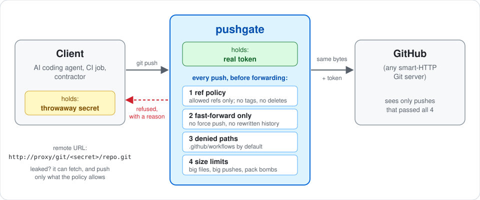

# git-proxy

Let an AI agent or a CI job push to GitHub **without giving it your token**.

<p align="center">
  
</p>

The client only gets a URL with a throwaway secret. git-proxy holds the real token, checks each
push, and forwards it to GitHub only if it passes.

> **Status: early.** Review it before you rely on it, and keep branch protection on.

## Quickstart

Needs Rust and `git`.

```sh
cargo install --git https://github.com/defi0x1/git-proxy
export GH_TOKEN=...
git-proxy --upstream https://github.com/you/repo.git --allow-ref 'refs/heads/agent/*'
# prints the URL to give the client: http://127.0.0.1:7777/git/<secret>/repo.git
```

Real run against GitHub (secret masked):

```text
$ git push origin agent/smoke-test:main
remote: git-proxy: push refused: refs/heads/main is not an allowed ref
To http://127.0.0.1:7799/git/<secret>/repo.git
 ! [remote rejected] agent/smoke-test -> main (refs/heads/main is not an allowed ref)
```

git-proxy's log for that session:

```text
allowed  refs/heads/agent/smoke-test (939 bytes)
refused  refs/heads/main: refs/heads/main is not an allowed ref
refused  refs/heads/agent/smoke-test: changes under .github/workflows are not allowed (.github/workflows/ci.yml)
```

No GitHub account at hand? `cargo run --example demo` runs the same thing against a local fake.

## What it refuses

| Push | Reason git shows |
|---|---|
| a ref not matching `--allow-ref` | `refs/heads/main is not an allowed ref` |
| a force push | `not a fast-forward: ... (force push is not allowed)` |
| a branch delete | `deleting a ref is not allowed` |
| a tag | `tags may not be pushed` |
| a change under `.github/workflows` | `changes under .github/workflows are not allowed (<file>)` |
| a file over 5 MiB, a push over 100 MiB, a pack bomb | `... over the <n> byte limit` |

Tags, deletes and extra denied paths are flags: `git-proxy --help`. To use it from Rust, see
`examples/demo.rs`.

## Limits

- Not seen: deleting the whole `.github/workflows` directory, or pointing a denied path at an
  object GitHub already has. Give the token no `workflows` permission to cover both.
- Anyone with the secret can clone the repo.
- One ref per push.
- Plain HTTP: keep it on localhost or behind TLS.

## License

MIT or Apache-2.0, at your option.
